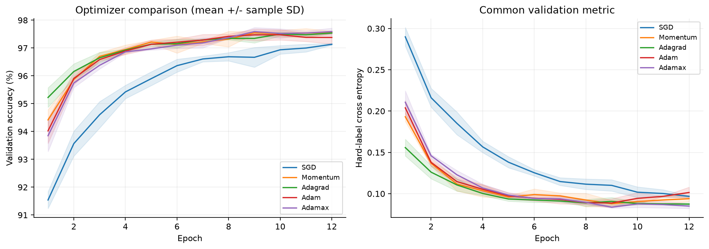
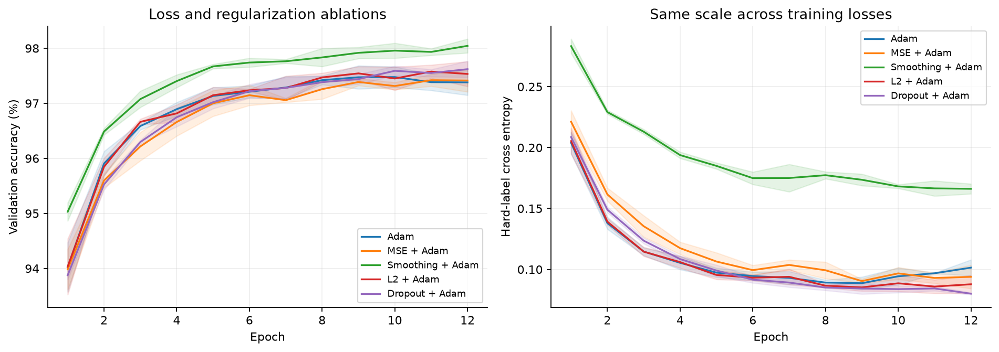
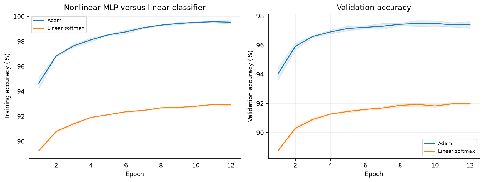
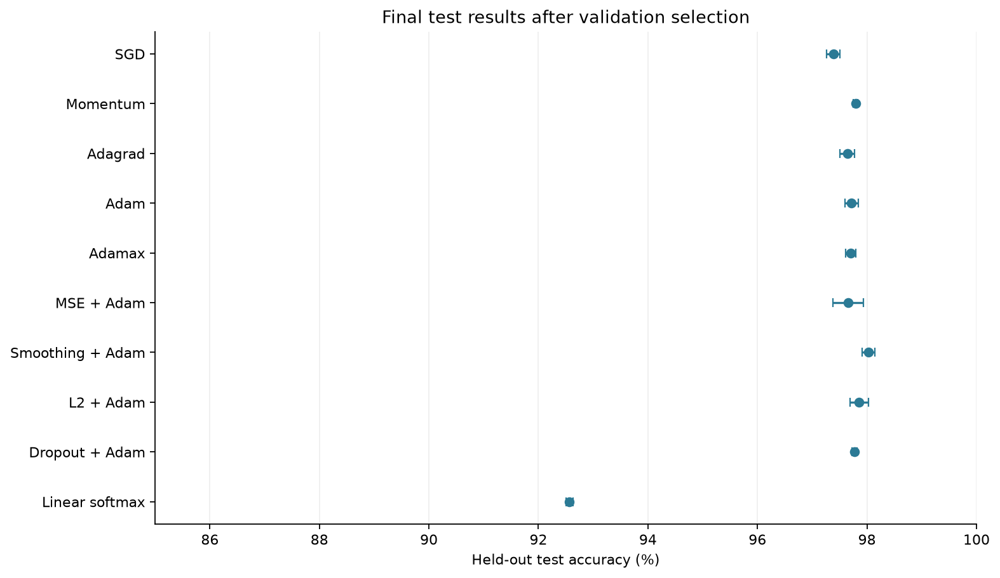
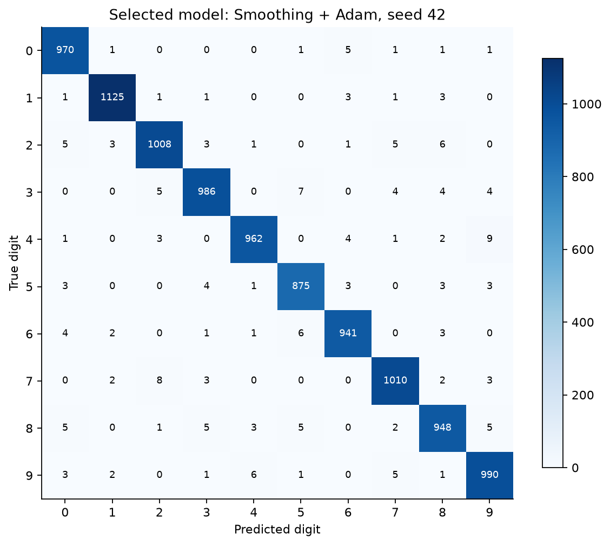

# A1：NumPy 全连接网络图像分类实验报告

## 1. 任务与完成范围

本实验使用 MNIST 手写数字数据集。
核心计算全部使用 NumPy。
实现范围包括前向传播、反向传播、参数更新和评估。
Matplotlib 只负责绘图。
项目未使用 PyTorch、TensorFlow 或 scikit-learn。

实验覆盖基础任务和 2 项附加题。
附加题包含损失函数、正则化方法和优化算法的对照。
线性分类器作为额外基线。
原目录 `A1` 保持不变。

## 2. 数据与实验协议

MNIST 包含 60,000 张原始训练图像和 10,000 张测试图像。
每张图像为 28×28 灰度图，标签为数字 0 至 9。
数据说明见 [MNIST 数据集文档](https://www.tensorflow.org/datasets/catalog/mnist)。
下载地址使用 [Google 托管的 MNIST 文件](https://storage.googleapis.com/cvdf-datasets/mnist/train-images-idx3-ubyte.gz)。
下载程序验证 4 个压缩文件的 MD5 摘要。
MD5 用于识别数据文件，不用于安全认证。

训练集包含 50,000 张图像。
验证集包含 10,000 张图像。
测试集包含 10,000 张图像。
训练集与验证集采用分层随机划分。
划分种子为 2026，索引保存在 `results/split_indices.npz`。
所有实验使用相同的划分。

像素值除以 255 后展平为 784 维向量。
预处理不估计测试集统计量。

学习率搜索只使用训练集与验证集。
每种优化器搜索 2 个预先设置的学习率。
每个候选训练 3 轮，搜索种子为 42。
正式实验使用种子 42, 43, 44。
同一种子使用相同的初始化与批次排列。
Dropout 使用独立随机数流。

每个正式实验训练 12 轮，批次大小为 128。
程序按验证准确率保存最佳轮次。
准确率相同时，程序选择硬标签交叉熵更小的轮次。
最终配置取 3 个种子的平均验证准确率最大者。
平均值相同时，程序取配置表中的首项。
最终模型固定采用种子 42。

程序在 `selection.json` 中保存选择结果。
程序随后加载测试集，评估所有已确定的模型。
测试结果不参与调参、选轮次或选模型。

## 3. 模型与手写计算

多层感知机（MLP）的结构为 `784 → 128 → 64 → 10`。
模型包含 109,386 个可训练参数。
隐藏层使用修正线性单元（ReLU）。
输出层产生 10 个未归一化分数。
Softmax 将分数转换为类别概率。

隐藏层采用 He 初始化。
输出层从均值为 0、方差为 `1 / fan_in` 的正态分布采样。
偏置初始化为 0。

设某层输入为 $A$，权重为 $W$，偏置为 $b$。
前向传播为 $Z=AW+b$。
隐藏层输出为 $\max(0,Z)$。
Softmax 先减去每行最大值，再计算指数。
交叉熵通过对数求和指数形式计算。
这两项处理用于避免数值溢出。

交叉熵为 $L=-\frac{1}{N}\sum_{i,k}q_{ik}\log p_{ik}$。
输出梯度为 $\partial L/\partial Z=(P-Q)/N$。
标签平滑使用 $q=(1-\alpha)y+\alpha/K$。
本实验设置 $\alpha=0.1$，$K=10$。
正确类别的目标值为 0.91，其余类别为 0.01。

均方误差（MSE）定义为 $L=\frac{1}{2N}\sum_{i,k}(p_{ik}-q_{ik})^2$。
MSE 先对概率求导，再乘 Softmax 的雅可比矩阵。
代码使用雅可比矩阵与向量的乘积，避免构造完整矩阵。

若上游梯度为 $G$，权重梯度为 $A^TG$。
偏置梯度为 $\sum_iG_i$，输入梯度为 $GW^T$。
ReLU 反向传播保留正输入位置的梯度。
各层按逆序计算梯度。
全部梯度计算完成后，优化器更新参数。

L2 惩罚为 $\lambda\sum_l\|W_l\|_F^2/2$。
权重梯度增加 $\lambda W_l$，偏置不受惩罚。
本实验设置 $\lambda=10^{-4}$。
Dropout 的丢弃概率为 0.2。
训练时保留的激活值除以 0.8。
评估时关闭 Dropout。

## 4. 对照设计与学习率搜索

随机梯度下降（SGD）按 $\theta\leftarrow\theta-\eta g$ 更新参数。
本实验的 SGD 每次使用一个小批次。
Momentum 设置动量系数为 0.9。
Momentum 累积方向信息后更新参数。

Adagrad 累积各参数的梯度平方。
Adam 维护梯度的一阶矩和二阶矩。
Adamax 使用梯度绝对值的衰减最大值。

Adam 与 Adamax 均校正一阶矩的初始偏差。
Adam 还校正二阶矩的初始偏差。
两者使用 $\beta_1=0.9$、$\beta_2=0.999$。
稳定项 $\epsilon=10^{-8}$。
更新公式位于 `src/a1_numpy/optim.py`。

| 搜索实验 | 学习率 | 最佳验证准确率（%） |
| --- | ---: | ---: |
| tune_sgd_0.03 | 0.03 | 92.03 |
| tune_sgd_0.1 | 0.1 | 94.43 |
| tune_momentum_0.01 | 0.01 | 94.93 |
| tune_momentum_0.03 | 0.03 | 96.70 |
| tune_adagrad_0.01 | 0.01 | 95.89 |
| tune_adagrad_0.03 | 0.03 | 96.59 |
| tune_adam_0.0003 | 0.0003 | 94.33 |
| tune_adam_0.001 | 0.001 | 96.63 |
| tune_adamax_0.001 | 0.001 | 94.51 |
| tune_adamax_0.003 | 0.003 | 96.51 |

选定学习率为：`{"sgd": 0.1, "momentum": 0.03, "adagrad": 0.03, "adam": 0.001, "adamax": 0.003}`。

优化器对照统一使用交叉熵和相同网络。
损失函数与正则化对照统一使用 Adam。
这些对照沿用交叉熵基线选定的 Adam 学习率。
每个对照只替换损失函数或一项正则化设置。
线性基线删除全部隐藏层，直接计算 Softmax 分类。
线性基线也沿用 Adam 的学习率。

## 5. 正式实验结果

表中准确率采用百分比。
“±”后的数值为 3 个种子的样本标准差。
宏平均 F1 也乘以 100。
时间是单次运行的平均耗时，单位为秒。
时间包含训练、验证、训练集评估和模型保存。
时间不能代表优化器更新公式的独立耗时。

| 实验 | 训练准确率（%） | 验证准确率（%） | 测试准确率（%） | 测试宏平均 F1 | 平均耗时（秒） |
| --- | ---: | ---: | ---: | ---: | ---: |
| `ce_sgd` | 98.80 ± 0.03 | 97.13 ± 0.03 | 97.39 ± 0.12 | 97.37 | 2.5 |
| `ce_momentum` | 99.67 ± 0.08 | 97.64 ± 0.07 | 97.79 ± 0.04 | 97.77 | 2.7 |
| `ce_adagrad` | 99.60 ± 0.08 | 97.54 ± 0.03 | 97.64 ± 0.13 | 97.62 | 3.0 |
| `ce_adam` | 99.46 ± 0.13 | 97.55 ± 0.12 | 97.72 ± 0.13 | 97.70 | 3.7 |
| `ce_adamax` | 99.45 ± 0.27 | 97.61 ± 0.14 | 97.70 ± 0.10 | 97.68 | 3.4 |
| `mse_adam` | 99.24 ± 0.23 | 97.48 ± 0.16 | 97.66 ± 0.28 | 97.64 | 3.7 |
| `smooth_adam` | 99.82 ± 0.01 | 98.04 ± 0.13 | 98.02 ± 0.12 | 98.01 | 3.8 |
| `l2_adam` | 99.50 ± 0.17 | 97.68 ± 0.12 | 97.86 ± 0.17 | 97.85 | 3.6 |
| `dropout_adam` | 99.24 ± 0.10 | 97.68 ± 0.12 | 97.77 ± 0.05 | 97.76 | 4.5 |
| `linear_adam` | 92.96 ± 0.03 | 92.02 ± 0.05 | 92.57 ± 0.07 | 92.45 | 1.1 |

所有训练准确率均来自所选轮次的完整训练集评估。
评估使用固定参数，并关闭 Dropout。
每轮在线损失另存为 `online_objective`。
评估按样本数加权，正确计入末尾不足一个批次的数据。

优化器组中，`ce_adagrad` 的首轮平均验证准确率最高。
按最佳轮次汇总，`ce_momentum` 的平均验证准确率最高。
不同算法的学习率来自相同规模的搜索。
这些结果仅适用于当前网络、候选学习率与训练轮数。
3 轮搜索偏向收敛较早的配置，可能漏掉后期表现更好的学习率。

以 `ce_adam` 为基线，结果变化如下。

- `mse_adam`：验证准确率变化 -0.07 个百分点。测试准确率变化 -0.06 个百分点。
- `smooth_adam`：验证准确率变化 +0.49 个百分点。测试准确率变化 +0.30 个百分点。
- `l2_adam`：验证准确率变化 +0.13 个百分点。测试准确率变化 +0.14 个百分点。
- `dropout_adam`：验证准确率变化 +0.13 个百分点。测试准确率变化 +0.05 个百分点。

| 实验 | 训练与验证准确率差值（百分点） | 测试交叉熵 | 平均最高类别概率（%） |
| --- | ---: | ---: | ---: |
| `ce_adam` | 1.90 | 0.0773 | 98.31 |
| `mse_adam` | 1.76 | 0.0839 | 98.10 |
| `smooth_adam` | 1.78 | 0.1636 | 87.82 |
| `l2_adam` | 1.82 | 0.0732 | 98.29 |
| `dropout_adam` | 1.56 | 0.0786 | 98.36 |

标签平滑提高了本次实验的平均验证准确率。
平均最大预测概率也随标签平滑降低。
软标签使模型减弱对单个类别的确定性。
硬标签交叉熵却有所升高，说明准确率与概率损失不一定同步改善。
平均最大概率不能单独证明概率校准得到改善。

Dropout 缩小了训练与验证准确率的差距。
L2 也缩小了差距，并提高了平均测试准确率。
这些现象与限制模型拟合能力的作用一致。
MSE 的平均准确率低于交叉熵基线。
MSE 的输出梯度还包含 Softmax 的雅可比矩阵。
这个因子可能减小饱和区域的梯度。

交叉熵和 MSE 的原始损失尺度不同。
报告使用硬标签交叉熵作为共同评价指标。
标签平滑的目标分布不同，也采用这个共同指标。
正则化方法不保证提高当前数据集的准确率。
具体判断应结合验证准确率、训练差距和随机种子波动。
单一强度的对照不能证明某种正则化方法始终有效或无效。

交叉熵 MLP 的平均验证准确率为 97.55%。
在线性基线上，平均验证准确率为 92.02%。
差值为 5.53 个百分点。
这项对照统一采用交叉熵和 Adam。
线性基线使用线性决策边界。
MLP 通过隐藏层学习非线性特征。

这项对照同时改变了参数量，不能单独量化非线性的贡献。

最终选择为 `smooth_adam`，依据是平均验证准确率。
最终单模型来自种子 42 的第 12 轮。
最终单模型的测试准确率为 **98.15%**。
测试宏平均 F1 为 **98.13%**。
最终模型文件为 `results/best_model.npz`。

## 6. 类别评估与错误分析

混淆矩阵的行是真实标签，列是预测标签。
最终单模型中，数量最多的 3 类误判为：4→9（9 张）、7→2（8 张）、3→5（7 张）。
矩阵揭示易混类别，不能单独解释每张图像的误判原因。

| 数字 | 精确率（%） | 召回率（%） | F1（%） | 样本数 |
| --- | ---: | ---: | ---: | ---: |
| 0 | 97.78 | 98.98 | 98.38 | 980 |
| 1 | 99.12 | 99.12 | 99.12 | 1135 |
| 2 | 98.25 | 97.67 | 97.96 | 1032 |
| 3 | 98.21 | 97.62 | 97.91 | 1010 |
| 4 | 98.77 | 97.96 | 98.36 | 982 |
| 5 | 97.77 | 98.09 | 97.93 | 892 |
| 6 | 98.33 | 98.23 | 98.28 | 958 |
| 7 | 98.15 | 98.25 | 98.20 | 1028 |
| 8 | 97.43 | 97.33 | 97.38 | 974 |
| 9 | 97.54 | 98.12 | 97.83 | 1009 |

## 7. 正确性验证与复现

`tests/test_core.py` 包含 18 项自动测试。
数值梯度测试使用中心差分和双精度浮点数。
测试覆盖交叉熵、MSE、标签平滑、L2 和 Dropout。
Dropout 梯度测试固定掩码，排除随机噪声。
测试还覆盖 5 种优化器的两步更新。

其余测试验证数据划分、模型保存恢复和指标计算。
合成数据测试验证模型是否能学会分类。
依赖检查验证源码未导入深度学习框架。

交付核对覆盖全部 30 次正式实验。
核对内容包含最佳轮次、模型加载和混淆矩阵。
最终模型按原配置重新训练后，所有参数逐项一致。
命令行推理也通过 8 张训练图像的核对。
核对记录见 `results/verification.json`。

Python 版本：`3.11.14`。
NumPy 版本：`2.4.6`。
环境基于 uv 管理的 Python 3.11。
依赖版本记录在 `uv.lock`。

核心源码摘要记录在 `results/manifest.json`。
正式训练累计耗时为 95.7 秒。
学习率搜索耗时另见 `results/tuning.csv`。
复现命令见 `README.md`。

## 8. 限制与结论

本实验使用一个固定数据划分和 3 个训练种子。
标准差描述初始化与批次顺序带来的波动。
重新划分数据带来的不确定性不在标准差的描述范围内。
本实验未实施统计显著性检验。

学习率候选只有 2 个，搜索轮数为 3。
损失函数和正则化对照未单独重新搜索学习率。
结论不代表各方法经过充分调参后的最优性能。
不同硬件和数值库可能产生数值及耗时差异。

本实验完成 NumPy 全连接图像分类流程。
基础实现包含手写前向传播、反向传播和评估。
对照实验覆盖两类损失、三种正则化和五种优化器。
所有报告数值均来自保存的实验结果。
