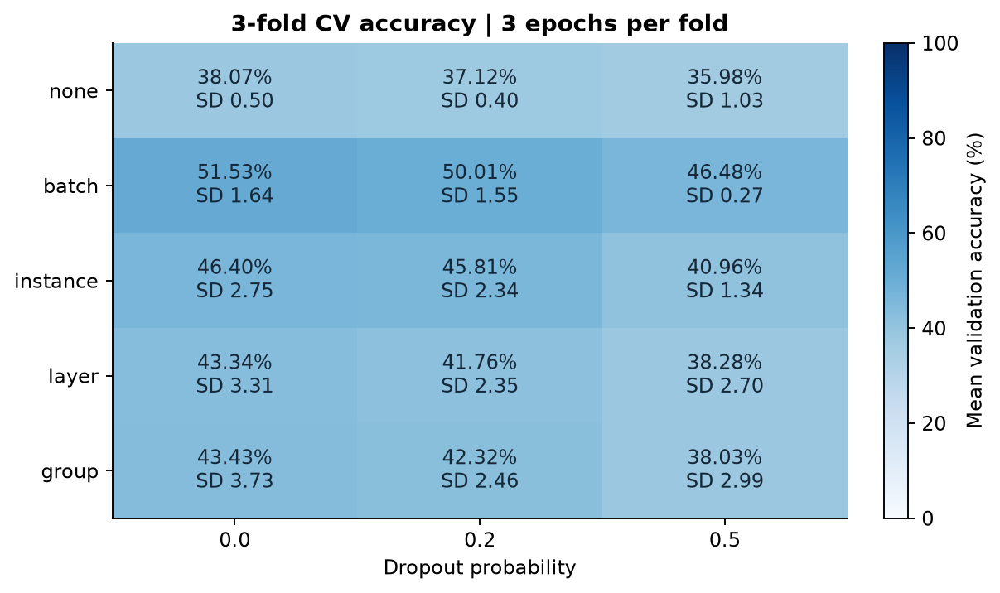
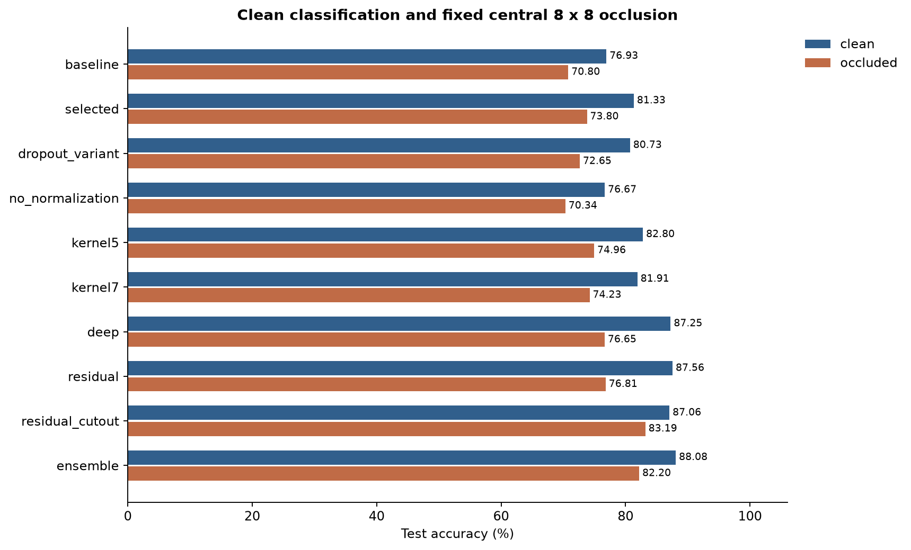
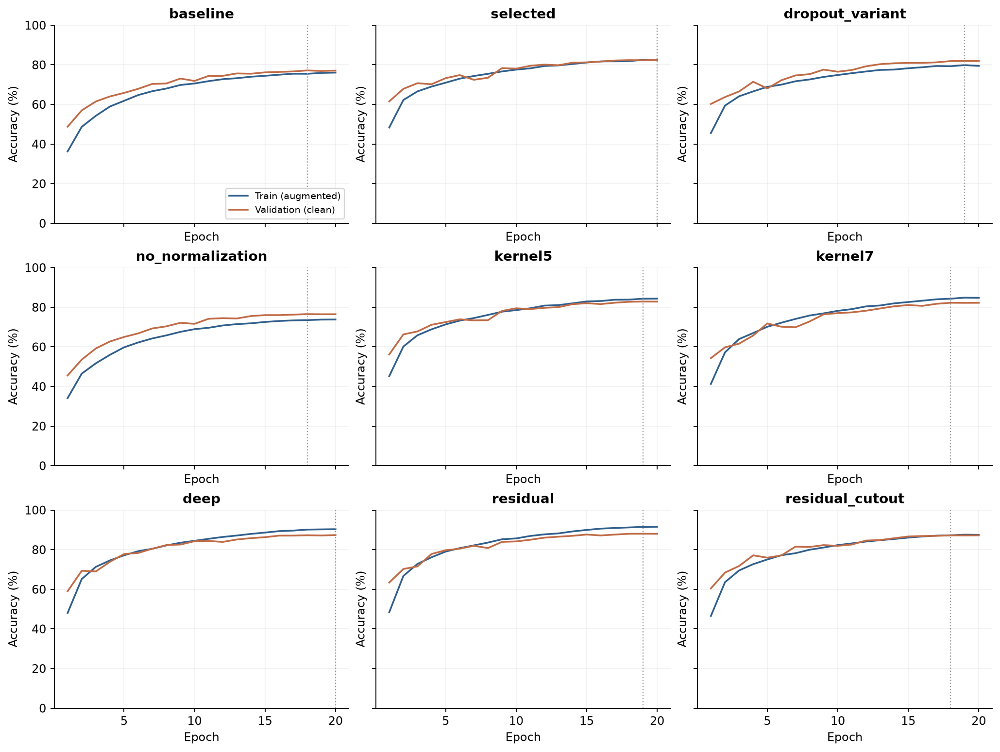
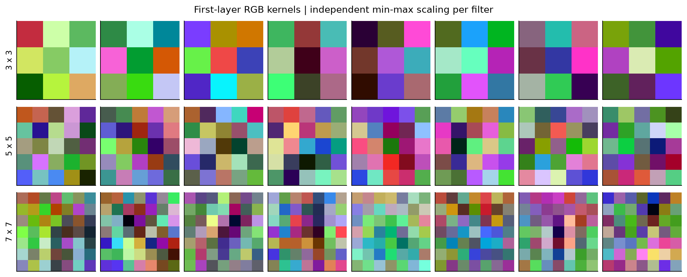
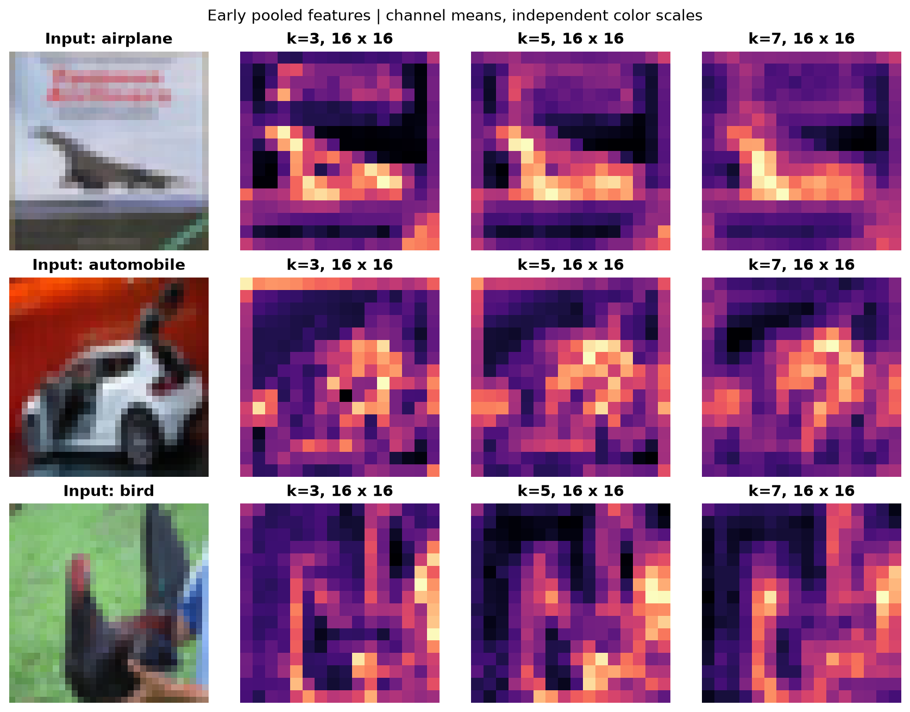
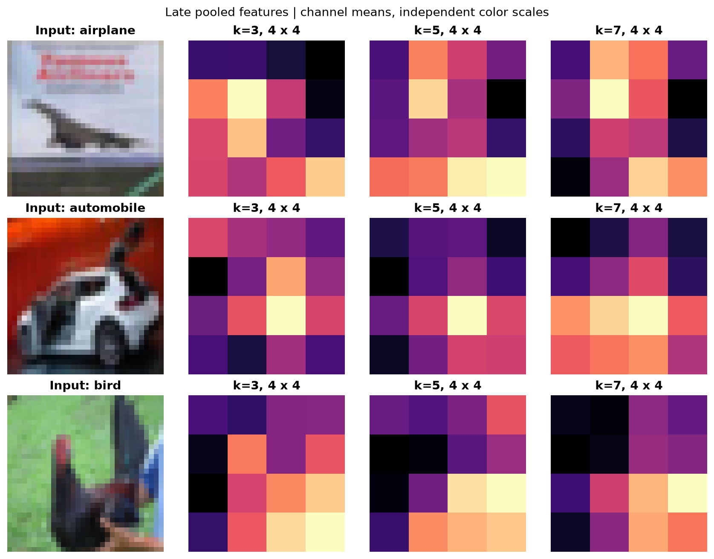
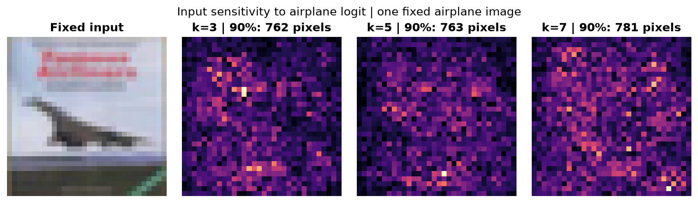
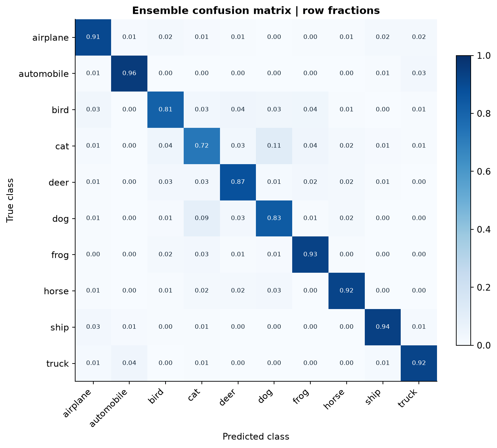
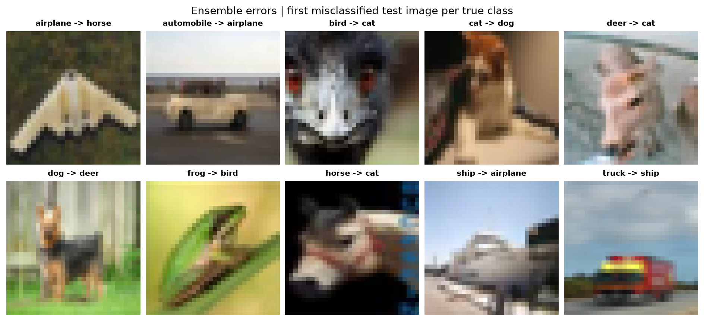

# A2：卷积网络

## 1. 任务与实验范围

本实验独立完成图像分类与 3 项附加任务。

| 任务                    | 实验                                     |
| ----------------------- | ---------------------------------------- |
| 卷积神经网络（CNN）分类 | 3 个卷积块、训练曲线、分类指标           |
| Dropout 与归一化        | 15 组参数的分层交叉验证与消融实验        |
| 超参数选择              | 按交叉验证平均准确率选择               |
| 提升性能                | 深层网络、残差连接、Cutout、模型集成     |
| 卷积核与表征            | 3×3、5×5、7×7，卷积核与特征图可视化      |
| 缺陷分析与验证          | 泛化差距、误分类、固定遮挡测试与改进实验 |

### 题目要求与代码对应说明

代码文件均位于 `src/cifar10_lab/`。下面按题目顺序说明实验、代码和报告章节。

**基础题：构建图像分类网络。** `models.py` 的 `Classifier` 定义卷积网络，`ConvBlock` 定义卷积块。`experiment.py` 的 `train_run` 训练模型，`evaluate_all` 计算测试准确率。第 3 节介绍结构，第 5 节展示训练曲线和分类结果。

**基础题：应用 Dropout 和多种归一化方法。** `models.py` 的 `Classifier` 在分类层中使用 `nn.Dropout`，`normalization` 创建 4 种归一化层及对照配置。`experiment.py` 的 `final_specs` 设置对照模型。第 4 节比较 15 组配置；第 5.1 节比较 `selected` 与 `dropout_variant`，说明 Dropout 的影响，再比较 `dropout_variant` 与 `no_normalization`，说明归一化的影响。

**基础题：通过交叉验证选择超参数。** `experiment.py` 的 `cross_validate` 将 9000 张训练图像分成 3 折，对每组配置训练 3 次，再按平均验证准确率选择配置。第 4 节给出各组均值、标准差和选中的配置。

**附加题 1：尝试提高分类准确率的方法。** `experiment.py` 的 `final_specs` 设置加深网络、残差连接和 Cutout 实验；`evaluate_all` 将 3 个模型的预测概率取平均，得到集成预测。`data.py` 的 `batch_transform` 实现训练时的随机遮挡。第 5.2 节比较深度、残差连接和集成，第 7.2 节比较 Cutout。

**附加题 2：比较卷积核大小并展示图像特征。** `models.py` 的 `ConvBlock` 根据 `kernel_size` 创建卷积层，`experiment.py` 的 `final_specs` 设置 3×3、5×5、7×7 对照。`report.py` 的 `visual_features` 绘制卷积核权重、特征图和输入梯度图。第 6 节结合这些图，比较准确率、参数量、运行时间和图像特征。

**附加题 3：分析模型缺陷并提出改进方案。** `data.py` 的 `occlude` 遮挡测试图像中心，`experiment.py` 的 `predict` 计算两种图像条件下的预测。`report.py` 的 `plot_confusion` 和 `plot_errors` 展示分类错误。第 7 节分析训练与验证准确率差距、遮挡影响和类别混淆，并用 Cutout 实验验证改善遮挡表现的方法。延后下采样和保留高分辨率分支列为后续方案。

表格中的 `model` 表示模型名称，`clean` 表示完整图像准确率，`occluded` 表示中心遮挡图像准确率。中心遮挡覆盖 8×8 像素，填充值为中灰色。

## 2. 数据与评估协议

CIFAR-10 包含 60,000 张 32×32 彩色图像。数据集有 10 个类别。[1]
官方训练集含 50,000 张图像，测试集含 10,000 张图像。

本次使用 fast.ai 的无损 PNG 归档。[2] 程序验证归档 SHA-256。
样本先按类别排序，再按文件名排序。数据来源记录见 `results/data_provenance.json`。

训练数据按类别分层划分。训练子集有 40,000 张，验证集有 10,000 张。
划分种子为 42，索引保存在 `results/split.json`。

训练增强包含反射填充后的随机裁剪，以及随机水平翻转。
全部图像按固定公式 `x / 255 × 2 − 1` 缩放。

验证和测试采用固定缩放公式。
每轮训练后，程序计算验证指标。验证准确率决定最佳权重。

程序在全部模型训练结束后计算测试指标。集成成员在测试评估前固定。
交叉验证指标用于选择配置，测试指标用于比较模型性能。

## 3. 模型与训练设置

浅层模型通道数为 32、64、128。
每个卷积块依次包含卷积、归一化、修正线性单元（ReLU）和 2×2 最大池化。

3 次池化后，特征图尺寸为 4×4。分类头包含 128 个隐藏单元和 10 个输出。
下表给出浅层模型的张量尺寸。B 表示批大小。

| 层                  | 输出尺寸   |
| ------------------- | ---------- |
| 输入                | B×3×32×32  |
| 第 1 个卷积块与池化 | B×32×16×16 |
| 第 2 个卷积块与池化 | B×64×8×8   |
| 第 3 个卷积块与池化 | B×128×4×4  |
| 展平                | B×2048     |
| 全连接与 ReLU       | B×128      |
| Dropout 与输出层    | B×10       |

分类头在隐藏激活后应用 Dropout。损失函数为交叉熵。
Dropout 在训练时以概率 p 将隐藏激活置零。保留的激活除以 `1−p`。

推理时关闭 Dropout，并使用全部隐藏单元。随机失活旨在减少隐藏单元间的依赖。[6]
归一化使用公式 `y = γ(x−μ)/sqrt(σ²+ε)+β`。不同方法的统计维度不同。

N、C、H、W 分别表示批大小、通道数、高度和宽度。

| 方法         | 均值与方差的计算范围             | 推理时的统计量         |
| ------------ | -------------------------------- | ---------------------- |
| BatchNorm    | 每个通道的批次与空间维度 N、H、W | 训练时累计的运行统计量 |
| InstanceNorm | 每张图像中，每个通道的 H、W      | 当前图像统计量         |
| LayerNorm    | 每张图像的全部 C、H、W           | 当前图像统计量         |
| GroupNorm    | 每张图像的组内通道与 H、W        | 当前图像统计量         |

本实验通过交叉验证和消融实验比较归一化配置的泛化表现。
BatchNorm 在训练时使用批次统计量，并在推理时使用运行统计量。[7]

深层模型将每个块的卷积数从 1 增至 2。残差模型增加 1×1 投影支路。[3]
残差模型采用自定义结构。

LayerNorm 使用 `nn.LayerNorm((C,H,W))`。程序归一化每张图像的全部特征。
InstanceNorm 启用仿射参数。GroupNorm 固定分为 4 组。

不同归一化方法的仿射参数数量不同。归一化层的仿射参数计入模型总参数量。
优化器为 AdamW，初始学习率为 0.001。权重衰减为 0.0005。

正式训练使用 20 轮，批大小为 256。学习率按余弦曲线衰减。
Cutout 在每张训练图像内随机遮挡一个 8×8 方块。[4] 遮挡值为归一化后的 0。

正式实验的训练种子为 42。

## 4. 交叉验证与超参数选择

程序从训练子集分层抽取 9000 张图像。交叉验证使用 3 折。
每折训练 3 轮。每个组合记录各折的最佳验证准确率。

搜索空间包含 5 种归一化配置和 3 个丢弃概率。丢弃概率为 0、0.2、0.5。
各组合复用相同折划分。每折重新初始化模型和优化器。

各折训练种子依次为 42、43、44。各组合复用每折种子。
程序按各折最佳准确率的平均值选择参数。同分时按配置顺序选择。

本次选中 `batch`，丢弃概率为 0.0。
选中组合的平均准确率为 51.53%，折间标准差为 1.64 个百分点。

折间标准差描述各折最佳验证准确率的离散程度。
各折验证结果用于比较参数组合的早期学习表现。

| 归一化   | Dropout | 平均准确率 | 折间标准差（百分点） |
| -------- | ------: | ---------: | -------------------: |
| batch    |     0.0 |     51.53% |                 1.64 |
| batch    |     0.2 |     50.01% |                 1.55 |
| batch    |     0.5 |     46.48% |                 0.27 |
| instance |     0.0 |     46.40% |                 2.75 |
| instance |     0.2 |     45.81% |                 2.34 |
| group    |     0.0 |     43.43% |                 3.73 |
| layer    |     0.0 |     43.34% |                 3.31 |
| group    |     0.2 |     42.32% |                 2.46 |
| layer    |     0.2 |     41.76% |                 2.35 |
| instance |     0.5 |     40.96% |                 1.34 |
| layer    |     0.5 |     38.28% |                 2.70 |
| none     |     0.0 |     38.07% |                 0.50 |
| group    |     0.5 |     38.03% |                 2.99 |
| none     |     0.2 |     37.12% |                 0.40 |
| none     |     0.5 |     35.98% |                 1.03 |

本次筛选中，5 种归一化配置均在丢弃概率 0 时取得最高均值。
交叉验证按平均准确率对配置排序。

Dropout 的正式消融结果见第 5.1 节。

各归一化配置使用相同的优化器和初始学习率。

## 5. 正式实验结果

测试集包含每类 1,000 张图像。宏平均 F1 对每个类别赋予相同权重。
下表汇总验证集所选权重对应的测试结果。

| 模型             |    参数量 | 最佳轮次 | 验证准确率 | 测试准确率 | 宏平均 F1 | 遮挡准确率 |
| ---------------- | --------: | -------: | ---------: | ---------: | --------: | ---------: |
| baseline         |   356,586 |       18 |     77.16% |     76.93% |    0.7674 |     70.80% |
| selected         |   357,034 |       20 |     82.44% |     81.33% |    0.8118 |     73.80% |
| dropout_variant  |   357,034 |       19 |     81.91% |     80.73% |    0.8064 |     72.65% |
| no_normalization |   356,586 |       18 |     76.54% |     76.67% |    0.7649 |     70.34% |
| kernel5          |   522,410 |       19 |     82.87% |     82.80% |    0.8273 |     74.96% |
| kernel7          |   770,474 |       18 |     82.25% |     81.91% |    0.8179 |     74.23% |
| deep             |   551,018 |       20 |     87.36% |     87.25% |    0.8721 |     76.65% |
| residual         |   561,354 |       19 |     88.04% |     87.56% |    0.8754 |     76.81% |
| residual_cutout  |   561,354 |       18 |     87.23% |     87.06% |    0.8701 |     83.19% |
| ensemble         | 1,469,406 |        — |          — |     88.08% |    0.8802 |     82.20% |

训练曲线记录训练增强下的准确率。验证曲线上记录的是干净图像的准确率。
训练阶段启用 Dropout，验证阶段使用全部隐藏单元。泛化差距采用干净训练准确率与验证准确率之差。

下表使用最佳权重，在关闭增强和 Dropout 后重算训练准确率。

| 模型            | 干净训练准确率 | 验证准确率 | 差距（百分点） |
| --------------- | -------------: | ---------: | -------------: |
| baseline        |         79.46% |     77.16% |           2.30 |
| selected        |         85.55% |     82.44% |           3.11 |
| deep            |         92.58% |     87.36% |           5.22 |
| residual        |         93.78% |     88.04% |           5.75 |
| residual_cutout |         91.70% |     87.23% |           4.47 |

### 5.1 正则化消融

选中模型相对基线的测试差值为 +4.40 个百分点。
本次交叉验证选中丢弃概率 0，正式对照使用丢弃概率 0.2。

保留归一化时，启用 Dropout 的测试差值为 -0.60 个百分点。
归一化的测试差值在保留非零 Dropout 时为 +4.06 个百分点。

本组对照分别考察 Dropout 与归一化的作用。

### 5.2 深度、残差与集成

加深网络的测试差值为 +5.92 个百分点。
加入残差支路后，测试差值为 +0.31 个百分点。

残差支路同时增加投影参数。
集成固定使用 `selected`、`deep` 和 `residual_cutout`。

集成对 3 个模型的类别概率取等权平均。
集成相对选中浅层模型的测试差值为 +6.75 个百分点。

集成同时增加推理计算量和模型存储量。

## 6. 卷积核大小与特征表征

3 个模型分别使用 3×3、5×5 和 7×7 主干卷积。通道数和训练预算保持相同。
池化后的理论感受野按卷积与池化的递推公式计算。

理论感受野包含填充区域。分类头综合全部 4×4 特征，覆盖整张输入。

| 卷积核 | 最后池化单元的理论感受野边长 |  参数量 | 运行耗时（秒） | 测试准确率 |
| ------ | ---------------------------: | ------: | -------------: | ---------: |
| 3×3    |                      22 像素 | 357,034 |          100.4 |     81.33% |
| 5×5    |                      36 像素 | 522,410 |          167.0 |     82.80% |
| 7×7    |                      50 像素 | 770,474 |          258.8 |     81.91% |

耗时包含训练和逐轮验证，也计入权重保存与干净训练集评估。
模型在相同设备上顺序运行。

图中展示第一层的前 8 个 RGB 卷积核。每个卷积核独立缩放颜色。
独立缩放用于观察卷积核内部的相对权重与空间结构。

各模型使用相同的 3 张固定测试图像。图中显示池化特征的通道平均值。
早期特征尺寸为 16×16，后期特征尺寸为 4×4。

每张热图按自身数值范围缩放，用于展示通道平均激活的空间分布。

输入敏感性图使用飞机类别 logit 对输入的绝对梯度。3 个模型使用相同目标类别。
程序在通道维度求和。输入为固定的第 1 张飞机测试图像。

标题给出累计 90% 梯度质量所需的像素数。
梯度描述飞机类别输出对输入像素变化的局部敏感性。

下表汇总空间响应和输入敏感性。空间熵先归一化至 0 至 1（含）。
空间熵使用通道平均激活在空间位置上的概率分布。表中取 3 张图像的均值。

空间熵接近 1 表示响应分布均匀。空间熵降低时，响应集中于部分位置。

| 卷积核 | 早期空间熵 | 后期空间熵 | 90% 输入梯度质量的像素数 |
| ------ | ---------: | ---------: | -----------------------: |
| 3×3    |     0.9867 |     0.9928 |                      762 |
| 5×5    |     0.9826 |     0.9951 |                      763 |
| 7×7    |     0.9863 |     0.9927 |                      781 |

空间熵衡量通道平均激活在空间位置上的集中程度。不同模型分别学习各自的通道特征。
通道平均将多个通道的响应汇总为一张空间图。独立色标突出每张图内部的响应差异。

热图呈现各模型的空间响应差异。
分类头汇总全部空间位置，形成整张图像的分类预测。

大卷积核在单层中整合更宽的邻域。堆叠小卷积核在相同感受野内增加非线性。
固定深度下，卷积核边长增加时，理论感受野随之扩大。

5×5 模型相对 3×3 模型的测试差值为 +1.47 个百分点。
相对 3×3 模型，7×7 模型的测试差值为 +0.58 个百分点。

卷积核增大时，感受野、参数量和计算量同步增加。
深层 3×3 与浅层 5×5 的理论感受野边长均为 36 像素。

深层 3×3 的参数量比浅层 5×5 多 5.48%。
深层 3×3 相对浅层 5×5 的测试差值为 +4.45 个百分点。

这组对照展示了非线性层数和参数量共同变化时的分类表现。
后续可缩减大卷积核模型的通道数，再验证等参数预算下的差异。

## 7. 模型缺陷与实验验证

### 7.1 泛化差距

训练与验证使用相同预处理后，准确率差距用于描述拟合差异。
本实验通过 Dropout、权重衰减和数据增强开展正则化实验。

残差模型的干净训练与验证差距为 5.75 个百分点。
加入 Cutout 后，差距为 4.47 个百分点。

泛化差距与测试准确率分别描述训练拟合差异和测试集分类表现。

### 7.2 遮挡敏感性

测试时固定遮挡图像中心的 8×8 区域。遮挡占输入面积的 6.25%。
遮挡值为中灰色。实验采用固定中心遮挡压力测试。

`residual` 与 `residual_cutout` 使用相同结构和训练预算。后者增加训练遮挡。
Cutout 的干净测试差值为 -0.50 个百分点。

Cutout 的遮挡测试差值为 +6.38 个百分点。
固定中心遮挡下，残差模型与 Cutout 模型的准确率分别为 76.81% 和 83.19%。

| 预定对比                   | 差值（百分点） | 配对自助法 95% 区间 |
| -------------------------- | -------------: | ------------------: |
| Cutout：干净图像           |          -0.50 |      [-1.10, +0.08] |
| Cutout：遮挡图像           |          +6.38 |      [+5.59, +7.14] |
| 集成相对浅层模型：干净图像 |          +6.75 |      [+6.18, +7.34] |

区间使用 2,000 次配对重采样。每次重采样保持同一图像的两组预测配对。
配对重采样区间描述固定模型在测试图像抽样变化下的差值波动。

表中逐项报告 3 组预定对比的 95% 区间。

### 7.3 类别混淆与细节丢失

集成模型出现频次最高的 3 个定向混淆如下。

-   `cat` → `dog`：114 张。
-   `dog` → `cat`：89 张。
-   `cat` → `bird`：43 张。

32×32 图像限制可用细节。连续池化进一步降低空间分辨率。
后续改进方案包括延后下采样和保留高分辨率分支。

程序按测试集索引顺序，为每个真实类别选取第 1 个误分类样本。

## 8. 运行说明

运行命令见 `README.md`。程序保存数据索引和配置，以及环境、权重和逐轮指标。

## 参考资料

[1] [CIFAR-10 数据集说明](https://www.cs.toronto.edu/~kriz/cifar.html)。

[2] [fast.ai CIFAR-10 图像归档](https://s3.amazonaws.com/fast-ai-imageclas/cifar10.tgz)。

[3] He et al. [Deep Residual Learning for Image Recognition](https://arxiv.org/abs/1512.03385), 2015。

[4] DeVries & Taylor. [Improved Regularization of Convolutional Neural Networks with Cutout](https://arxiv.org/abs/1708.04552), 2017。

[5] [PyTorch LayerNorm 文档](https://docs.pytorch.org/docs/stable/generated/torch.nn.LayerNorm.html)。

[6] Srivastava et al. [Dropout: A Simple Way to Prevent Neural Networks from Overfitting](https://jmlr.org/papers/v15/srivastava14a.html), 2014。

[7] Ioffe & Szegedy. [Batch Normalization: Accelerating Deep Network Training by Reducing Internal Covariate Shift](https://proceedings.mlr.press/v37/ioffe15.html), 2015。
